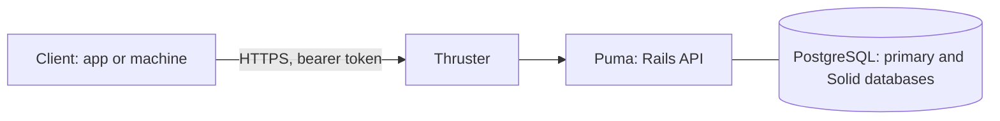

# 01 — Architecture

The application is one deployable Rails 8.1 API-only application. It is
built from Rails engines that live in the same repository, each with a
declared place in one dependency graph. Packwerk checks that code
crosses an engine boundary only along that graph and only through the
other engine's public surface.



`Acme` stands for the application namespace, `billing` for an example
engine and `invoices` for an example resource (`00_README.md`).

## Rules

### ARCH-01 — One deployable API built from engines (MUST · ADR-15)

The repository builds one container image that serves one Rails API
application. Its code lives in engines under `engines/`; the root
`app/` and `config/` are the composition root, which mounts the engines
and holds only what belongs to no engine (the root application class,
the routes that mount engines, the health endpoint, environment
configuration).

An engine is a Rails engine and a Ruby gem without its own release:

- it has a gemspec, `lib/<engine>/engine.rb` and `lib/<engine>.rb`;
- it isolates its namespace, so `engines/billing` defines
  `Acme::Billing` and its tables, routes and helpers stay inside it;
- its gemspec declares no runtime gem dependencies; every external gem
  is pinned in the root `Gemfile` (ADR-16);
- the root `Gemfile` loads every engine through one glob over
  `engines/*/*.gemspec`, so adding an engine does not edit it.

No service is split out of the application. A separately deployed
service needs an ADR.

### ARCH-02 — Three engine kinds, one direction (MUST · ADR-08)

Every engine is one of three kinds. The composition root sits above
them all.

| Kind | Example | Holds |
| --- | --- | --- |
| kernel | `engines/core` | what every engine builds on |
| domain | `engines/customers` | a concept several engines share |
| product | `engines/billing` | one product area and its endpoints |
| root | `app/`, `config/` | mounting and app-wide setup |

What each kind may depend on:

- **core** depends on nothing in the repository. There is exactly one
  kernel engine.
- **A domain engine** depends on core and on the domain engines it
  declares. It has no routes and no controllers.
- **A product engine** depends on core, on the domain engines it
  declares, and on the public surface of the product engines it
  declares. It owns its routes, controllers and endpoints.
- **The root** may depend on every engine. No engine depends on the
  root.

A dependency always points downward: product to domain to kernel. A
domain engine never depends on a product engine. When two product
engines need the same concept, the concept moves into a domain engine;
it does not move into core.

### ARCH-03 — The kernel holds only the shared machinery (MUST · ADR-08)

`engines/core` (`Acme::Core`) holds what every request or every engine
needs and nothing about a business concept:

- the base controller, which authenticates the bearer token, sets the
  tenant for the request and renders errors (`02_api_contract.md`,
  `03_identity_access.md`);
- the error responder and the error codes shared by every engine;
- token, scope and tenant models with their tables, and the base policy
  (`03_identity_access.md`);
- the base record class and the tenant scoping it applies
  (`04_data.md`);
- the base command, query and value object classes (`05_domain.md`);
- the base job class, which carries the tenant into the job
  (`06_async_integration.md`);
- pagination, serialization helpers and the outbound HTTP client
  (`02_api_contract.md`, `06_async_integration.md`);
- the generators (`11_generators.md`).

A class enters core only when the kernel machinery itself needs it, or
when every engine needs it and it names no business concept. "Two
engines need it" is a reason for a domain engine, not for core. Core's
size has a budget (ARCH-10).

### ARCH-04 — One declared graph in package.yml files (MUST · ADR-08)

Each engine, and the root, is a Packwerk package. The `dependencies:`
list in its `package.yml` is the only record of the dependency graph;
anything else that needs the graph reads it from there.

```yaml
# engines/billing/package.yml
enforce_dependencies: strict
enforce_privacy: strict
enforce_layers: true
layer: product
dependencies:
  - engines/core
  - engines/customers
```

```yaml
# packwerk.yml
require:
  - packwerk/privacy/checker
  - packwerk/layer/checker
layers:
  - root
  - product
  - domain
  - kernel
```

- `bin/packwerk validate` refuses a declared graph with a cycle and an
  invalid package file.
- `bin/packwerk check` fails on a constant reference to a package that
  is not declared. With `enforce_dependencies: strict`, a new violation
  cannot be recorded in a `package_todo.yml` either.
- The layer checker from `packwerk-extensions` fails when a package
  depends on a package in a higher layer, which is how ARCH-02's
  direction is checked. Layers are listed from highest to lowest.

Changing a `dependencies:` list or a layer is a guard change: the pull
request says so and a person approves it.

### ARCH-05 — No recorded violations (MUST · ADR-08)

The repository commits no `package_todo.yml`. A boundary violation is
fixed in the pull request that introduces it, never recorded for later.
`bin/packwerk update-todo` is not part of any workflow.

### ARCH-06 — Engines meet only at public surfaces (MUST · ADR-08)

Each engine exposes to other engines only the constants under its
`app/public/` folder, the default `public_path` of the privacy checker
in `packwerk-extensions`. `enforce_privacy: strict` makes every
reference to any other constant of the engine a violation, with no
`package_todo.yml` escape. Core follows the same rule, so its base
classes live in `engines/core/app/public/`.

A public surface holds:

- the command and query objects other engines may call;
- the value objects those calls take and return;
- the names of the events the engine publishes (`05_domain.md`);
- for core, the base classes the other engines inherit from.

Active Record models, controllers, serializers and jobs are never
public. Another engine reads data through a public query object and
changes it through a public command object, so the owning engine keeps
its invariants.

A public interface changes additively first: add the new call, move the
callers, then remove the old call in a later pull request.

Packwerk resolves only constants that Zeitwerk autoloads. Engine code
therefore lives under `app/`, where Zeitwerk loads it; `lib/` holds
only the engine and gem files and the generators.

### ARCH-07 — Each table belongs to one engine (MUST · ADR-08)

- A table belongs to the engine whose migration creates it, and its
  name starts with that engine's name: `core_tokens`,
  `billing_invoices`.
- The engine's migrations live in `engines/<engine>/db/migrate/` and
  run from there; they are never copied into the root `db/migrate/`.
  The root holds no tables of its own.
- Only the owning engine's models map the table. Another engine never
  reads or writes it with SQL, a model or a view.
- Active Record associations never cross an engine boundary. A row in
  one engine refers to a row in another by its ID.
- A foreign key may point only to a table of an engine in the declared
  dependencies (ARCH-04).

Column types, constraints, IDs, tenancy columns and row-level security
are defined in `04_data.md`.

### ARCH-08 — No coupling around the graph (MUST · ADR-08)

Engines can couple without naming each other's constants. Each such
channel is closed or constrained:

- **Reflection.** `constantize`, `safe_constantize`, `const_get` and
  string `class_name:` options are not used in engines, so Packwerk
  sees every reference.
- **Tables.** Only through the owner's public surface (ARCH-07).
- **Configuration.** `config.x` is read and written only in core; an
  engine keeps its own settings in its own configuration object.
- **Cache keys.** Every key starts with the owning engine's name.
- **Jobs.** An engine enqueues only its own jobs; work for another
  engine goes through that engine's public command.
- **Events.** Event names are constants in the publisher's public
  surface; subscribers depend on the publisher (`05_domain.md`).
- **Routes.** An engine builds URLs only for its own routes.

### ARCH-09 — Engine-owned files live in the engine (MUST · ADR-08)

A change to one engine stays inside its folder, and root files only
aggregate. Each engine holds:

- `package.yml` (ARCH-04) and its gemspec;
- `app/`, with `app/public/` as its surface (ARCH-06);
- `config/routes.rb`, product engines only;
- `config/locales/`, its error messages and other copy;
- `db/migrate/`, when it owns tables (ARCH-07);
- `spec/`, its own specs and factories (`10_testing.md`);
- its part of the OpenAPI document, product engines only, where
  `02_api_contract.md` says.

The root `config/routes.rb` mounts each product engine under the API
path; it defines no endpoint of an engine.

### ARCH-10 — Growth has budgets (SHOULD · ADR-08)

An engine design fails slowly: shared code drifts into core, core grows,
every change touches it, and the boundaries stop meaning anything.
Budgets make the drift visible while it is cheap to reverse. They live
in the root `config/budgets.yml`, under `growth:`.

| Budget | Measures |
| --- | --- |
| Core size | files and public constants in `engines/core` |
| Domain surface | public constants of each domain engine |
| Engine size | files and endpoints of each product engine |
| Fan-in | product engines that depend on one product engine |

- Size budgets are set when the first engines exist and recorded in the
  file; until then the file holds no value and the check is skipped.
- Fan-in defaults to 3. A product engine with more dependents holds a
  shared concept that belongs in a domain engine.
- Core and domain engines are not counted for fan-in: they exist to be
  depended on, so their size budgets apply instead.
- Raising a budget needs an ADR. Lowering one needs nothing.

`12_enforcement.md` names the check for each budget and its status.

## Request flow

1. Thruster terminates HTTP in the container and passes the request to
   Puma.
2. The Rails middleware stack runs: request ID, logging, rate limits
   (`08_security.md`, `09_observability_ops.md`).
3. The root router sends the request to the product engine mounted at
   its path.
4. The engine's controller inherits core's base controller, which finds
   the bearer token, checks it and its scopes, and opens the tenant for
   the request (`03_identity_access.md`).
5. The controller checks the request against the OpenAPI document,
   authorizes it with a policy, and calls one command or one query
   object (`02_api_contract.md`, `05_domain.md`).
6. The command or query uses the engine's models and the public surface
   of the engines it depends on (ARCH-06).
7. A serializer renders the result as JSON; core's error responder
   renders every error in one format (`02_api_contract.md`).
8. Work that can wait is enqueued as a job, which carries the tenant
   (`06_async_integration.md`).

## Directory layout

```text
.
├── app/                    # composition root: no domain code
├── config/
│   ├── budgets.yml         # growth budgets (ARCH-10)
│   └── routes.rb           # mounts product engines
├── db/                     # schema files; no root migrations
├── engines/
│   ├── core/               # kernel (ARCH-03)
│   │   ├── app/public/     # surface (ARCH-06)
│   │   ├── db/migrate/     # core_ tables
│   │   ├── lib/generators/ # generators (11_generators.md)
│   │   ├── spec/
│   │   └── package.yml
│   ├── customers/          # example domain engine
│   └── billing/            # example product engine
│       ├── app/
│       │   ├── controllers/
│       │   ├── models/
│       │   └── public/
│       ├── config/routes.rb
│       ├── db/migrate/     # billing_ tables
│       ├── spec/
│       ├── billing.gemspec
│       └── package.yml
├── package.yml             # root package
└── packwerk.yml
```

The folders inside `app/` that hold commands, queries, value objects,
policies and serializers are named in `05_domain.md` and
`02_api_contract.md`. The example engines show every kind; an adopter
replaces them with generated engines (`11_generators.md`).
